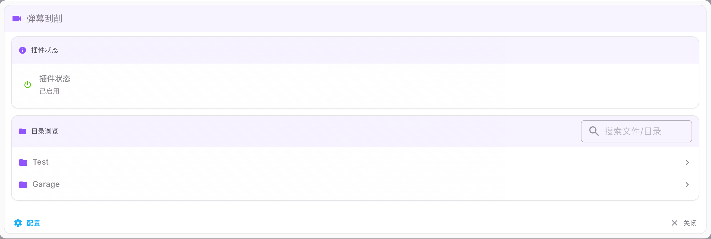

# 弹幕刮削

此插件根据文件匹配弹弹平台上的弹幕,将弹幕文件转换为ass格式字幕,用于实现在不支持弹幕播放的设备上模拟弹幕.

### 手动匹配与搜索
- 前端支持搜索弹弹番剧并手动匹配，可选“目录”或“单文件”范围；单文件仅作用于该文件。
- 手动匹配数据保存在目录下 `.dandan.anime.json`（旧 `.id` 会自动转换并删除）；单文件匹配存储在插件缓存。
- 手动匹配支持“集数偏移”：本地集数 + 偏移 = 弹弹集数。用于 TMDB 连续计数而弹弹按季重置的番剧，如本地 S02E13 对应弹弹第二季第 1 集则填 `-12`。
- 生成的弹幕文件为 UTF-8 无 BOM `.danmu.ass`，合并中文字幕时为原字幕事件补充 `{\blur10}` 提升可读性。

### 文件匹配规则
首先会尝试使用文件hash直接匹配文件,如果没有匹配到怎会尝试使用TMDB ID来进行匹配.

### 关于「无收录」

弹弹play 以**番剧弹幕**为主。国产剧、综艺、演唱会、欧美剧、低幼动画等内容通常不在它的收录范围内,这类文件刮削时会显示「弹弹play 未收录该内容」。

**这不是匹配失败**,而是对方确实没有这部作品的弹幕数据。对这类文件重复刮削、做手动匹配、调整配置都不会有结果。

另有一种情况是「已收录,但暂时没有弹幕」——条目存在但还没有人发弹幕,新番刚放送时常见,之后可能会有,插件会定期复查。

### 请求限速
弹弹play 对「文件识别」类请求有每日配额,中转服务器也按 IP 限速。插件对所有弹弹play 请求做了统一限速(30 请求/分钟),遇到 429/503 会自动退避,退避期间批量刮削会中止本批并留待下次执行——被限流不等于没有弹幕,因此不会计入重试次数。

「刮削并发数」控制的是本机同时处理的文件数(ffprobe 取时长、计算 hash、生成与合并字幕),和对服务器的请求速率是两回事,调小它并不能减轻服务器压力。

### 更新日志

-  v1.11.0: **大幅减少对弹弹play 的请求**——新增本地刮削状态库，记住每个文件的识别结果（弹幕ID）、内容状态（服务端弹幕数）与渲染配置，三者失效条件不同、分别管理；新增**整季查询**，一次拿到整部作品的剧集列表，同一部剧的后续集数零请求定位（178 集的剧从每轮 178 次问变成 1 次）；复查改为**指数退避**，按「已收录/暂无弹幕/未收录」与内容新旧分档，取代原来「重试 10 次就放弃」的硬截断——那个截断既会在新番弹幕正在增长时提前放弃，又会被下一次全局刮削原样加回，形成无限循环。
**区分「未收录」与「刮削失败」**：弹弹play 未收录的内容此前被报成红色错误，会误导用户去重复刮削和手动匹配（而这些都不可能奏效），现改为中性提示并说明原因；「已收录但暂无弹幕」单独区分，会按计划复查。批量刮削结束时在目录层一次性汇总，未收录占比过半时说明弹弹play 以番剧弹幕为主。
**集数匹配更准**：接入季号后可自动推导集数偏移（TMDB 连续计数 vs 弹弹按季重置），用户不必再手工填写；支持特典与第 0 集（放送前特番）；推导季偏移时排除特典，避免整季弹幕静默错位。
**改配置后存量文件会重新生成**：字体、屏幕区域、分辨率等改动会让已有弹幕文件重新生成，此前改了配置对存量文件毫无反应。
**未安装 ffmpeg 时直接使用 TMDB 匹配**并给出一次明确提示，不再对每个文件白算 16MB 哈希后发出注定失败的请求。
-  v1.10.0: **「仅从B站获取」改为「优先使用B站弹幕」**——B站弹幕不足时自动回退全部来源。此前实测绝大多数剧集根本没有B站来源的弹幕，开启该选项会让大部分文件写出空弹幕并每 3 小时反复重试，而重试永远改变不了结果；回退只在原本就拿不到弹幕时触发，纯B站内容的行为不变。**修复集号越界导致弹幕串到别的作品**：弹幕ID编码为 `animeId*10000+集号`，此前集号无上界校验，集号 ≥10000 会进位到另一部作品、≥9000 会落进特典段，且全程无报错；现改为校验 `0-8999`，越界回退常规匹配。**支持第0集**（放送前特番/序章是合法集数，此前被静默改成第1集）。**修复目录手动匹配对 .strm 文件静默失效**，以及手动匹配目录仍白算 16MB 哈希 + ffmpeg 时长的浪费。**修复 .strm 文件缺少 TMDB ID 时的无限空转**：此前零请求即判失败并永久占据重试列表，现明确识别为「重试无法改变结果」并移出列表。**新增客户端限速**——所有弹弹play请求收敛到统一入口，令牌桶限速 30 请求/分钟并复用连接；遇到 429/503 时按 `Retry-After` 退避，且**不再把「被限流」误判为「没有弹幕」**，也不计入重试次数（此前服务端每拦一次，客户端反而多排一次重试）；服务端长时间限流时批量刮削中止本批、剩余文件留待下次执行；新增「刮削并发数」配置（只影响本机开销，对服务器的请求另有限速）。修复字幕匹配时 Ep1 会误命中 Ep10 的字幕；双集文件（如 E13-E14）改为按首集匹配弹幕；API 接口限制在配置的刮削路径内，拒绝越界读写；插件停止时可中止正在运行的批量刮削；`/update_path` 接口改为持久化保存；修复弹幕数据字段不足时的越界读取；前端轮询失败不再每 3 秒弹一次错误
-  v1.9.0: 手动匹配新增集数偏移，解决 TMDB 连续集数与弹弹按季重置集数不一致的问题，支持目录/单文件两种范围；新增一键刮削整个目录，后台批量执行并实时显示进度；修复弹弹 API 请求无超时、重试任务并发读写不安全、同一文件被并发刮削的问题
-  v1.6.2: 优化 blur 标签逻辑，仅对普通底部字幕添加模糊效果，特效字幕保持原样
-  v1.6.1: 弹幕文件改为 UTF-8 无 BOM，合并中文字幕时增加 `{\blur10}` 模糊标签
-  v1.6.0: UI 支持手动匹配范围选择（目录/单文件），兼容 `.dandan.anime.json` 存储
-  v1.4.0: 修复文件路径无法访问的问题,新增无弹幕或者弹幕数量过少时定时重试
-  v1.3.0: 新增联邦组件支持, 增加UI手动刮削, 需求MP v2.4.5+
-  v1.2.0: 针对新番（90天内发布的媒体资源）使用较短时间缓存以获取最新弹幕数据
-  v1.1.15: 增加根据路径刮削弹幕功能。增加单文件路径刮削。能力有限无法在同一个页面实现按钮功能……
-  v1.1.13: 先检查当前目录下有没有.id结尾的文件 如果有，则获取文件名作为弹幕ID（如190270001 则使用19027.id)。如果需要请访问 https://dandanapi.hankun.online/docs 尝试获取epsoide id。
-  v1.1.11: 修复弹幕获取过滤错误
-  v1.1.10: 使用TMDB ID作为预备匹配方案，当无法匹配文件hash时尝试使用TMDB ID。
-  v1.1.8: 增加了中转服务器，恢复了对弹弹的访问以及缓存。修复透明度问题。增加了弹幕过滤选项。
